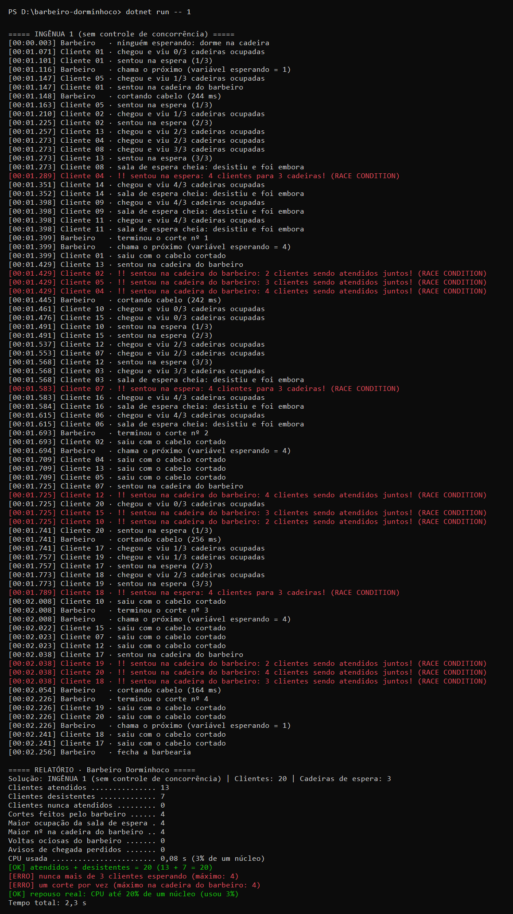
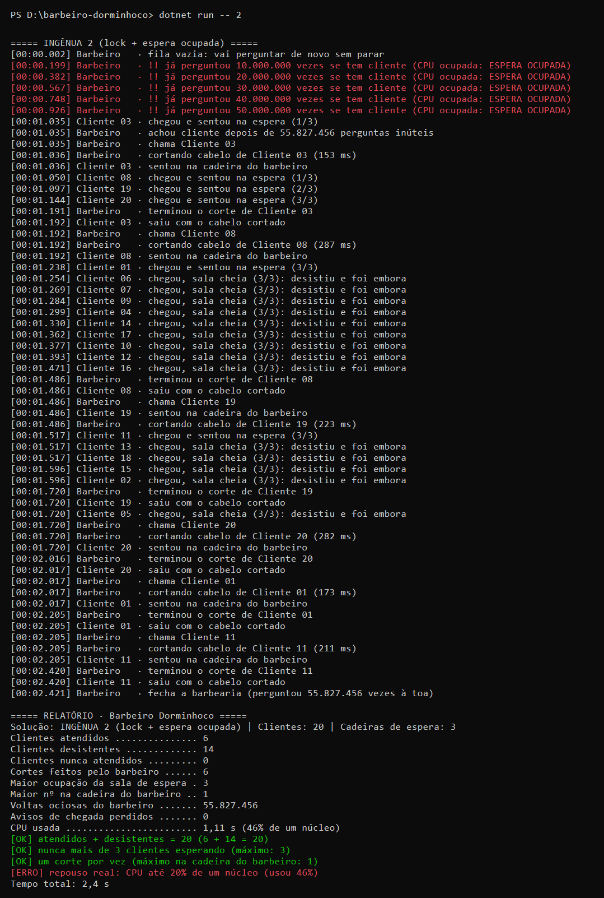
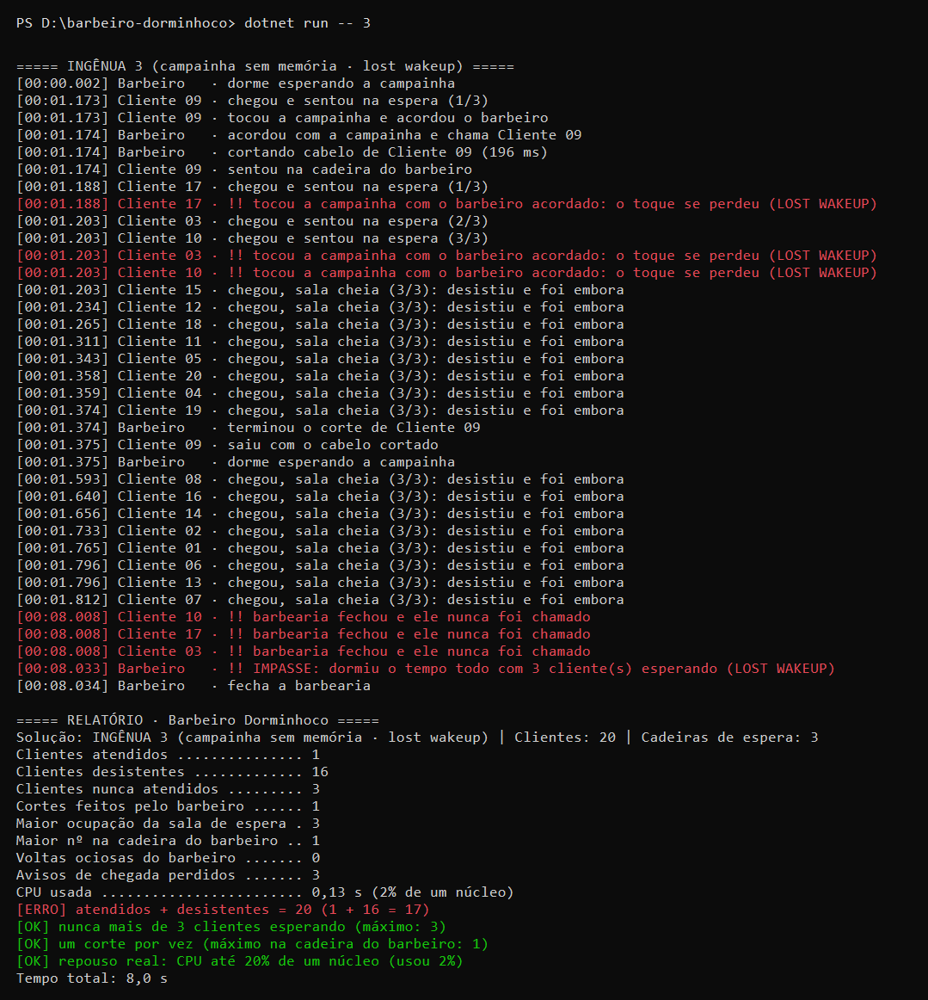

# Trabalho N3 · O Barbeiro Dorminhoco

**Disciplina:** Desenvolvimento para Concorrência (ESW240) · UniRV · 7º período
**Aluno:** Rogger Guimarães
**Problema:** 4 · Barbeiro Dorminhoco (Dijkstra, 1965) · referência: Aula 10
**Ambiente:** C# · .NET 10 · aplicação console

## Como executar

```bash
dotnet run          # abre o menu
dotnet run -- 2     # roda direto a opção 2, sem menu
```

| Opção | Solução | O que acontece |
|---|---|---|
| 1 | Ingênua 1 · sem controle de concorrência | Race condition: mais de 3 clientes na espera e vários na cadeira do barbeiro |
| 2 | Ingênua 2 · lock + laço infinito | Espera ocupada: o barbeiro pergunta milhões de vezes e gasta CPU com a barbearia vazia |
| 3 | Ingênua 3 · campainha sem memória (`Monitor.Pulse`) | Lost wakeup: avisos se perdem e o barbeiro dorme com clientes esperando (impasse) |
| 4 | Solução ideal (`SemaphoreSlim` + `lock`) | Entrega 3 |
| 5 | Comparar desempenho | Entrega 3 |
| 0 | Sair | |

Todos os parâmetros do cenário (clientes, cadeiras, tempos, janela da corrida, prazo) ficam em [`Config.cs`](Config.cs).

---

## Entrega 0 · Estudo do problema

### O cenário

Uma barbearia tem **1 barbeiro**, **1 cadeira de corte** e **3 cadeiras de espera**. Chegam **20 clientes** em instantes aleatórios.

- Sem clientes, o barbeiro dorme na própria cadeira.
- O cliente que chega e encontra o barbeiro dormindo o acorda.
- Se o barbeiro estiver ocupado e houver cadeira livre, o cliente senta e espera.
- Se as 3 cadeiras estiverem ocupadas, o cliente **desiste** e vai embora.

### Quem são as threads

| Thread | Quantidade | O que faz |
|---|---|---|
| **Barbeiro** | 1 (`Task`) | Thread servidora: dorme enquanto não há clientes, chama o próximo, corta o cabelo e repete. |
| **Cliente** | 20 (`Task` cada) | Chega em um instante aleatório (`Random.Shared`), olha a sala, senta e espera ou desiste, é atendido e vai embora. |

### Quais recursos elas disputam

| Recurso | Quem disputa | Por quê |
|---|---|---|
| **Contador de cadeiras de espera** (`esperando`) | Clientes entre si (ler e incrementar) e barbeiro (ler e decrementar) | É o estado compartilhado que decide se ainda há vaga. Ler e depois gravar sem proteção é um *check-then-act*. |
| **Cadeira do barbeiro** (o atendimento) | Clientes que estão esperando | Só um cliente pode ser atendido por vez. |
| **O sinal "chegou cliente" / "próximo!"** | Cliente → barbeiro e barbeiro → cliente | Se o aviso de chegada se perde, o barbeiro dorme com gente esperando; se o chamado é visto por dois clientes, dois sentam na cadeira. |
| **CPU** | Barbeiro (quando espera) | Um barbeiro que "espera" perguntando sem parar consome processamento sem fazer trabalho útil. |

### As 4 regras de uma barbearia segura

1. **Corte exclusivo** · apenas um cliente é atendido por vez (nunca 2 na cadeira do barbeiro).
2. **Fila limitada** · nunca mais de 3 clientes na sala de espera; o 4º desiste.
3. **Repouso real** · sem clientes, o barbeiro dorme sem gastar CPU (nada de espera ocupada).
4. **Despertar exato** · nenhum aviso de chegada se perde; todo cliente que sentou é atendido.

### Soluções ingênuas que serão implementadas

| Solução | Ideia | Problema que deve provocar | Regras violadas |
|---|---|---|---|
| **Ingênua 1** · sem controle | Cliente lê `esperando`, e se houver vaga faz `esperando++`, tudo sem lock. O barbeiro chama o próximo ligando uma flag comum. | **Condição de corrida (race condition)**: entre olhar e sentar, outro cliente vê a mesma vaga → 4 ou 5 clientes em 3 cadeiras; dois clientes veem o mesmo chamado → 2 na cadeira do barbeiro. | 1 e 2 |
| **Ingênua 2** · lock + laço infinito | O contador passa a ser protegido por `lock`, mas o barbeiro fica em `while (true) { lock { if (esperando > 0) ... } }` perguntando sem parar. | **Espera ocupada (busy waiting)**: barbearia vazia e um núcleo de CPU perto de 100%; o barbeiro ainda segura o lock o tempo todo e atrasa quem quer entrar. | 3 |
| **Ingênua 3** · dormir e acordar sem contador | O barbeiro dorme em `Monitor.Wait` e o cliente toca a "campainha" com `Monitor.Pulse`; o barbeiro atende um cliente por toque. | **Lost wakeup (sinal perdido)**: `Pulse` não tem memória. O cliente que toca enquanto o barbeiro está cortando perde o aviso, e o barbeiro dorme para sempre com clientes esperando (impasse). | 4 |

### Solução ideal

**Ferramenta:** dois `SemaphoreSlim(0)` e um contador protegido por `lock` (Aula 10).

| Variável | Valor inicial | Papel |
|---|---|---|
| `clientes` | `SemaphoreSlim(0)` | Conta clientes esperando. O cliente faz `Release()`; o barbeiro faz `Wait()` e dorme de verdade se for 0. |
| `barbeiro` | `SemaphoreSlim(0)` | O barbeiro faz `Release()` quando chama o próximo; o cliente faz `Wait()` até chegar a sua vez. |
| `esperando` | `int = 0` com `lock` | Controla as 3 cadeiras: olhar e sentar viram uma única operação atômica; excedentes desistem. |

Por que resolve: `Release()` **guarda** o aviso no contador interno do semáforo (regra 4), `Wait()` bloqueia a thread sem consumir CPU (regra 3), o `lock` torna o *check-then-act* das cadeiras atômico (regra 2) e o barbeiro libera um cliente por vez (regra 1). Ao final, os clientes terminam e um `CancellationTokenSource` encerra o barbeiro, então o programa termina sozinho.

### As 3 verificações automáticas do relatório

1. `[OK]` **atendidos + desistentes = 20** · nenhum cliente sumiu ou ficou sem resposta.
2. `[OK]` **nunca mais de 3 clientes esperando** · maior ocupação real da sala de espera ≤ 3.
3. `[OK]` **um corte por vez** · nunca houve mais de 1 cliente na cadeira do barbeiro.

Além das 3 obrigatórias, o relatório tem uma 4ª verificação para a regra 3: **repouso real**, que dá `[ERRO]` se o processo usar mais de 20% de um núcleo em média (CPU medida com `Process.TotalProcessorTime`).

As medições usam uma classe de instrumentação própria ([`Infra/Estatisticas.cs`](Infra/Estatisticas.cs)) com `Interlocked`, separada das variáveis de cada solução: assim o relatório mede o que realmente aconteceu, mesmo quando a solução ingênua "acha" outra coisa.

---

## Entrega 1 · Cenário e Solução Ingênua 1

### Estrutura do projeto

| Arquivo | Responsabilidade |
|---|---|
| [`Config.cs`](Config.cs) | Parâmetros do cenário em um único lugar (requisito 1). |
| [`Barbearia.cs`](Barbearia.cs) | Cenário comum: cria o barbeiro e os 20 clientes como `Task`, com chegada aleatória por `Random.Shared` (requisito 2), espera todos e imprime o relatório. |
| [`Solucoes/Ingenua1SemControle.cs`](Solucoes/Ingenua1SemControle.cs) | Solução Ingênua 1, sem nenhum controle de concorrência. |
| [`Infra/Logger.cs`](Infra/Logger.cs) | Log de cada evento com horário e autor (requisito 5). |
| [`Infra/Estatisticas.cs`](Infra/Estatisticas.cs) | Contadores reais (instrumentação). |
| [`Infra/Relatorio.cs`](Infra/Relatorio.cs) | Relatório com as 3 verificações `[OK]`/`[ERRO]`. |

### O que acontece na Ingênua 1

O cliente executa, sem lock:

```csharp
int vistos = _esperando;                  // 1. olha
if (vistos >= Config.CadeirasEspera) { /* desiste */ }
Thread.Sleep(Config.JanelaCorridaMs);      // janela entre olhar e sentar
_esperando++;                              // 2. senta
```

Quando a sala tem 2 ocupadas, dois clientes que chegam quase juntos leem `esperando = 2`, os dois concluem "tem 1 vaga" e os dois sentam: **4 clientes em 3 cadeiras**. O `Thread.Sleep` só alarga a janela que já existe entre a leitura e a escrita, para o erro aparecer em toda execução.

O mesmo acontece com o chamado do barbeiro: ele liga `_chamando = true`, e cada cliente que está esperando confere a flag e a desliga. Dois clientes podem ver `true` antes de alguém desligar, e os dois sentam na cadeira do barbeiro.

No log, essas linhas aparecem em vermelho com `!! ... (RACE CONDITION)`, e no relatório as verificações 2 e 3 dão `[ERRO]`.

Execução real (`dotnet run`): a sala de espera chegou a 4 clientes para 3 cadeiras e até 4 clientes sentaram juntos na cadeira do barbeiro, enquanto ele fez só 4 cortes para 15 clientes "atendidos".



---

## Entrega 2 · Demais soluções ingênuas e menu

Arquivos novos: [`Program.cs`](Program.cs) (menu), [`Solucoes/Ingenua2EsperaOcupada.cs`](Solucoes/Ingenua2EsperaOcupada.cs), [`Solucoes/Ingenua3SinalPerdido.cs`](Solucoes/Ingenua3SinalPerdido.cs) e [`Solucoes/Ficha.cs`](Solucoes/Ficha.cs) (a ficha do cliente na fila, com os eventos "chamado", "corte terminado" e "levantou").

O relatório ganhou os contadores **voltas ociosas do barbeiro**, **avisos de chegada perdidos** e **CPU usada**. A barbearia agora abre 1 s antes do primeiro cliente (`Config.AberturaMs`), para mostrar como cada solução espera quando não há ninguém.

### Ingênua 2 · espera ocupada

O que mudou: a fila de espera fica dentro de um `lock`, então olhar e sentar viram uma operação só, e o barbeiro tira um cliente por vez. Com isso as verificações 1, 2 e 3 dão `[OK]`.

O problema: o barbeiro não tem como dormir. Ele fica neste laço:

```csharp
while (!ct.IsCancellationRequested)          // o while (true) do slide
{
    lock (_trava) { if (_fila.Count > 0) proximo = _fila.Dequeue(); }
    if (proximo is null) { voltas++; continue; }   // 0 clientes: pergunta de novo, JÁ!
    ...
}
```

No 1 s em que a barbearia está vazia ele perguntou **mais de 55 milhões de vezes** se havia cliente, e o processo usou **46% de um núcleo** em média só com isso. A cada volta ele ainda pega o `lock`, disputando a "porta" com os clientes que querem sentar. Viola a regra 3 (repouso real), e a 4ª verificação dá `[ERRO]`.



### Ingênua 3 · lost wakeup

O que mudou: o barbeiro passa a dormir de verdade em `Monitor.Wait`, então a CPU fica perto de 0%. A ideia ingênua é "cada cliente toca a campainha uma vez, então eu acordo uma vez por cliente":

```csharp
// cliente, depois de sentar
lock (_campainha) { Monitor.Pulse(_campainha); }

// barbeiro
lock (_campainha) { Monitor.Wait(_campainha); }   // dorme até tocar
// tira UM cliente da fila, corta e volta a dormir sem olhar a fila
```

O problema: `Monitor.Pulse` só acorda quem **já está** em `Monitor.Wait`. Os clientes que chegam enquanto o barbeiro está cortando tocam a campainha, mas ninguém está esperando, e o toque some. Ao terminar o corte, o barbeiro volta a dormir com 3 clientes na sala, e eles esperam para sempre: **impasse**. O programa só termina por causa do prazo de 8 s (`Config.PrazoIngenuaMs`). A verificação 1 dá `[ERRO]` (1 atendido + 16 desistentes = 17, faltam 3). Viola a regra 4 (despertar exato).

É exatamente isso que a solução ideal corrige: o `SemaphoreSlim` **conta** os `Release()`, então o aviso fica guardado mesmo se o barbeiro não estiver esperando naquele instante.



---

## Ferramentas de IA usadas

- Claude (Anthropic) · apoio na geração do código e na redação do README.
